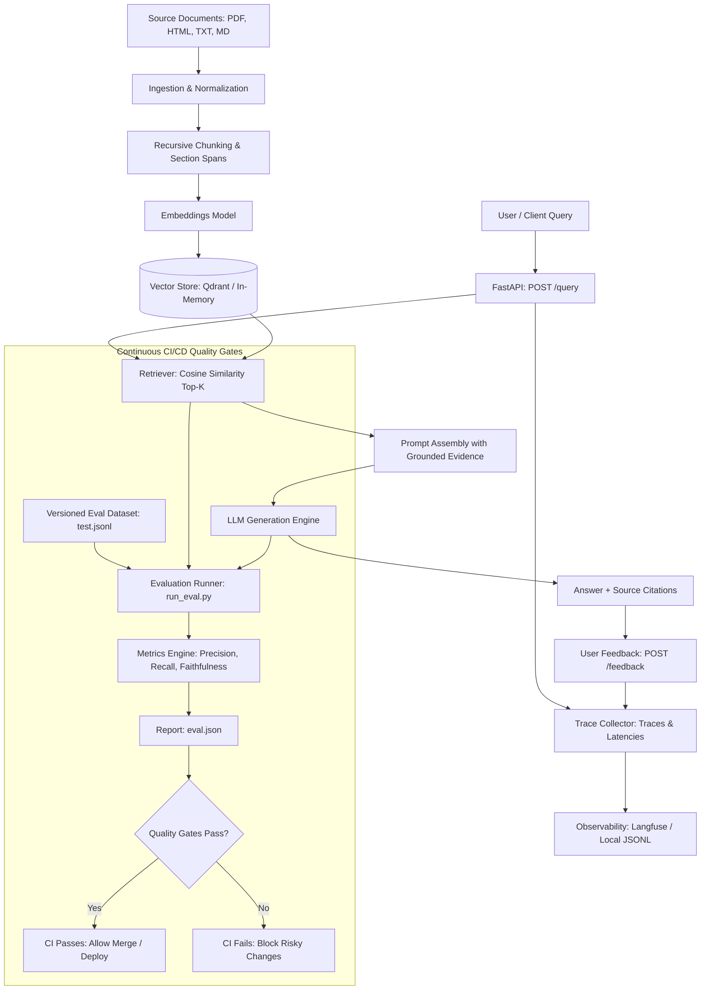

# RAGOps: Automated RAG Evaluation & Continuous CI/CD

Enterprise-grade Retrieval-Augmented Generation (RAG) system with synthetic evaluation dataset generation, automated quality benchmarking, pull-request quality gates, and end-to-end request tracing with user feedback.

---

## 1. Architecture Overview



---

## 2. Quickstart & Installation

### Prerequisites
- Python 3.11+
- Git

### Local Setup
```bash
# 1. Clone and navigate to repository
cd RAGOps

# 2. Create and activate a virtual environment
python3 -m venv .venv
source .venv/bin/activate

# 3. Install dependencies in editable mode
pip install -e ".[dev]"

# 4. Copy environment configuration
cp .env.example .env
```

### Docker Compose Setup
To launch the FastAPI service alongside a persistent Qdrant vector database:
```bash
docker compose up --build
```
The API is available at `http://localhost:8000` and Swagger docs at `http://localhost:8000/docs`.

---

## 3. Core Commands

### Run Unit and Integration Tests
```bash
# Using pytest
pytest tests/ -v

# Or using Python's built-in test runner
python -m unittest discover tests
```

### Build Vector Index
Populate the vector database with source documents:
```bash
python scripts/build_index.py --input data/raw
```

### Generate Synthetic Evaluation Dataset
Generate Question-Context-Answer test cases from your corpus:
```bash
python -m app.evaluation.generate_dataset --input data/raw --output data/eval/test.jsonl --samples 10
```

### Run Evaluation Benchmark
Execute benchmark queries, calculate metrics, and output a detailed report:
```bash
python -m app.evaluation.run_eval --dataset data/eval/test.jsonl --output reports/eval.json
```

### Enforce CI Quality Gates
Inspect the report and block the build if quality thresholds are violated:
```bash
python -m app.evaluation.quality_gates --report reports/eval.json
```

### Demonstrate CI Failure on Regressed Changes
To verify that quality gates fail when a regressed pipeline is submitted:
```bash
# 1. Run evaluation with deliberate regression flag
python -m app.evaluation.run_eval --dataset data/eval/test.jsonl --output reports/eval_regressed.json --regress

# 2. Check quality gates (exits with code 1 and blocks deployment)
python -m app.evaluation.quality_gates --report reports/eval_regressed.json
```

---

## 4. Quality Gate Policy & Metrics

| Metric | Threshold | Measurement Goal |
| :--- | :--- | :--- |
| **Context Recall** | `>= 0.90` | Fraction of reference evidence captured in retrieved chunks |
| **Context Precision** | `>= 0.70` | Mean Average Precision of relevant chunks at top ranks |
| **Faithfulness** | `>= 0.85` | Ratio of answer claims directly grounded in retrieved text |
| **Hallucination Rate** | `<= 0.02` | Ratio of ungrounded or unsupported claims |
| **Answer Relevancy** | `>= 0.80` | Relevance of answer content to user query |

---

## 5. Sample Evaluation Report

Sample generated report (`reports/eval.json`):

```json
{
  "metadata": {
    "timestamp": "2026-10-10T19:20:12Z",
    "dataset_file": "data/eval/test.jsonl",
    "total_cases": 6,
    "regressed_mode": false,
    "pipeline_config": {
      "chunk_size": 500,
      "chunk_overlap": 50,
      "top_k": 3,
      "embedding_provider": "hash",
      "embedding_model": "all-MiniLM-L6-v2",
      "llm_provider": "mock",
      "llm_model": "gpt-4o-mini"
    }
  },
  "metrics": {
    "context_recall": 1.0,
    "context_precision": 1.0,
    "faithfulness": 1.0,
    "hallucination_rate": 0.0,
    "answer_relevancy": 0.9107,
    "total_samples": 6,
    "latency_p50_ms": 0.25,
    "latency_p95_ms": 0.31
  }
}
```

CLI Quality Gate Output:
```text
======================================================================
                      CI QUALITY GATES VERIFICATION
======================================================================
 METRIC                 | ACTUAL     | CRITERIA     | STATUS  
----------------------------------------------------------------------
 Context Recall         | 1.0000     | >= 0.90      | PASS    
 Context Precision      | 1.0000     | >= 0.70      | PASS    
 Faithfulness           | 1.0000     | >= 0.85      | PASS    
 Hallucination Rate     | 0.0000     | <= 0.02      | PASS    
 Answer Relevancy       | 0.9107     | >= 0.80      | PASS    
======================================================================

SUCCESS: All quality gates PASSED! Pull request / build approved.
```

---

## 6. API Reference

| Method | Endpoint | Description |
| :--- | :--- | :--- |
| `GET` | `/health` | Service health status and indexed vector counts |
| `POST` | `/ingest` | Ingest documents from path or inline payload |
| `POST` | `/query` | Retrieve relevant chunks and generate answer with citations |
| `POST` | `/feedback` | Submit thumbs up/down rating tied to a `trace_id` |
| `GET` | `/metrics` | Operational performance: p50/p95 latencies, tokens, feedback ratio |
| `POST` | `/evaluate` | Run evaluation benchmark job via API |

---

## 7. Observability & Tracing

- Every `/query` request produces a unique `trace_id`.
- The trace records:
  - Input question
  - Retrieved chunk IDs, relevance scores, and metadata
  - Generated answer and inline citations
  - Token counts (prompt, completion, total)
  - Latencies (retrieval, generation, total end-to-end)
  - Linked thumbs up/down user feedback
- Traces are stored in `reports/traces.jsonl` and can sync directly to **Langfuse** by setting `LANGFUSE_PUBLIC_KEY` and `LANGFUSE_SECRET_KEY` in `.env`.

---

## 8. Limitations & Production Considerations

1. **Synthetic Data Calibration**: Synthetic datasets should be calibrated against curated human-verified cases before setting hard CI blocking thresholds.
2. **Evaluator Flakiness**: In high-throughput CI environments, use a sample size of at least 20-50 cases to dampen variance from individual outlier generations.
3. **Data Security**: Ensure documents ingested into production do not contain unauthorized PII. Retrieved text is protected against prompt injection via demarcated XML-style boundary blocks.

---

## 👨‍💻 Author

<div align="center">

<a href="https://github.com/iitking">
  
</a>

### **Nivesh Kumar Meena**

**AI Architect · MLOps Engineer** | B.Tech Electrical Engineering, **IIT Roorkee**

*Building agentic AI systems, RAG pipelines and production-ready ML.*

<a href="https://www.linkedin.com/in/nivesh-kumar-meena-a31465221/"></a>
<a href="https://github.com/iitking"></a>
<a href="mailto:niveshkr149@gmail.com"></a>

<br/><br/>

⭐ **If you found this project useful, please give it a star!** ⭐

<sub>Open to AI/ML engineering opportunities and collaborations.</sub>

</div>

---

<div align="center">
  <sub>Made with ❤️ by <a href="https://github.com/iitking">Nivesh Kumar Meena</a> · © 2026 · MIT License</sub>
</div>

