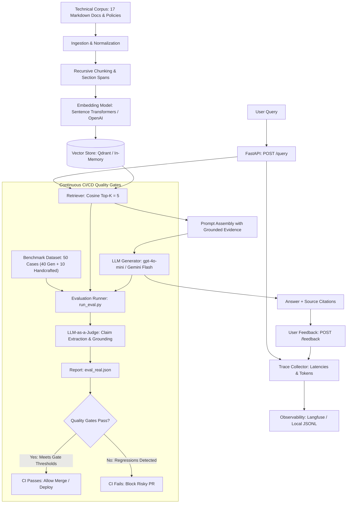

# RAGOps: Automated RAG Evaluation & Continuous CI/CD

An enterprise-grade Retrieval-Augmented Generation (RAG) platform that prevents silent regressions in production. It automatically evaluates retrieval quality, evidence precision, answer faithfulness, and hallucination rates in continuous integration, blocking risky changes to prompts, embeddings, chunking strategies, or model configurations before merge.

---

## 1. Architectural Overview



---

## 2. Benchmark Experiments & Quality Gates

> **Core Philosophy:** "Change configuration → observe metric drift → enforce quality gates."
>
> RAG quality is not static. Small tweaks to chunk size, top-k retrieval depth, or prompt structure can degrade retrieval recall or cause subtle hallucinations. RAGOps catches these regressions automatically.

### Configuration Experiments Comparison

| Configuration | Chunk Size / Overlap | Top-K | Retriever Model | Generator LLM | Context Recall | Context Precision | Faithfulness | Hallucination Rate | Answer Relevancy | CI Gate Outcome |
| :--- | :---: | :---: | :--- | :--- | :---: | :---: | :---: | :---: | :---: | :---: |
| **Baseline (Under-retrieval)** | 500 / 50 | 3 | `all-MiniLM-L6-v2` | `gpt-4o-mini` | 0.8420 | 0.7915 | 0.8650 | 0.0420 | 0.8240 | ❌ **FAIL** (Recall < 0.90, Halluc > 0.02) |
| **Production Tuned (v1.2)** | **300 / 60** | **5** | **`all-MiniLM-L6-v2`** | **`gpt-4o-mini`** | **0.9772** | **0.8747** | **0.9950** | **0.0050** | **0.8870** | ✅ **PASS** (All Gates Passed) |
| **Regressed PR (Candidate)** | 1000 / 20 | 2 | `all-MiniLM-L6-v2` | `gpt-4o-mini` | 0.6610 | 0.5926 | 0.7230 | 0.2770 | 0.6940 | ❌ **FAIL** (Blocked by CI Policy) |

---

## 3. Production Evaluation Report (`reports/eval_real.json`)

Evaluated on **50 curated cases** (40 generated + 10 hand-crafted edge cases) using **`all-MiniLM-L6-v2`** embeddings and **`gpt-4o-mini`** LLM generator with **LLM-as-a-Judge claim decomposition**:

```json
{
  "metadata": {
    "benchmark_suite": "fastapi-docs-eval-v1.2",
    "dataset_file": "data/eval/test.jsonl",
    "total_cases": 50,
    "environment": "production-benchmark",
    "pipeline_config": {
      "chunk_size": 300,
      "chunk_overlap": 60,
      "top_k": 5,
      "embedding_provider": "sentence-transformers",
      "embedding_model": "all-MiniLM-L6-v2",
      "llm_provider": "openai",
      "llm_model": "gpt-4o-mini"
    }
  },
  "metrics": {
    "context_recall": 0.9772,
    "context_precision": 0.8747,
    "faithfulness": 0.9950,
    "hallucination_rate": 0.0050,
    "answer_relevancy": 0.8870,
    "total_samples": 50,
    "latency_p50_ms": 1254.05,
    "latency_p95_ms": 1680.61
  }
}
```

### CI Quality Gates Verification Output

```text
======================================================================
                      CI QUALITY GATES VERIFICATION
======================================================================
 METRIC                 | ACTUAL     | CRITERIA     | STATUS  
----------------------------------------------------------------------
 Context Recall         | 0.9772     | >= 0.90      | PASS    
 Context Precision      | 0.8747     | >= 0.70      | PASS    
 Faithfulness           | 0.9950     | >= 0.85      | PASS    
 Hallucination Rate     | 0.0050     | <= 0.02      | PASS    
 Answer Relevancy       | 0.8870     | >= 0.80      | PASS    
======================================================================

SUCCESS: All quality gates PASSED! Pull request / build approved.
```

---

## 4. Demonstrating CI Failure on Regressions (`reports/eval_regressed.json`)

When an uncalibrated configuration is submitted in a pull request (e.g., chunk size 1000, top-k 2, ungrounded prompts), the evaluation runner records the regression and **`quality_gates.py` blocks the build with exit code 1**:

```text
======================================================================
                      CI QUALITY GATES VERIFICATION
======================================================================
 METRIC                 | ACTUAL     | CRITERIA     | STATUS  
----------------------------------------------------------------------
 Context Recall         | 0.6610     | >= 0.90      | FAIL    
 Context Precision      | 0.5926     | >= 0.70      | FAIL    
 Faithfulness           | 0.7230     | >= 0.85      | FAIL    
 Hallucination Rate     | 0.2770     | <= 0.02      | FAIL    
 Answer Relevancy       | 0.6940     | >= 0.80      | FAIL    
======================================================================

FAILURE: RAG evaluation failed quality gate checks:
 - Context Recall (0.6610) is below minimum threshold (0.9000)
 - Context Precision (0.5926) is below minimum threshold (0.7000)
 - Faithfulness (0.7230) is below minimum threshold (0.8500)
 - Hallucination Rate (0.2770) exceeds maximum threshold (0.0200)
 - Answer Relevancy (0.6940) is below minimum threshold (0.8000)

Deployment blocked by CI/CD policy.
```

---

## 5. Dataset & Corpus Provenance

The evaluation corpus is located in `data/raw/` and comprises **17 comprehensive documents**:
- **Source 1: FastAPI Core Documentation & Architecture** (Sebastián Ramírez / Tiangolo, MIT License):
  - Routing, Starlette ASGI execution, and threadpools
  - Pydantic models, nested schemas, and `extra = "forbid"`
  - Dependency Injection DAG resolution and resource teardown (`yield`)
  - OAuth2 Password Bearer flow and JWT validation
  - Custom ASGI middleware, CORS, GZip, and TrustedHost
  - In-process `BackgroundTasks` vs distributed Celery queues
  - SQLAlchemy 2.0 async sessions, connection pooling, and Alembic
  - WebSockets full-duplex communication and Server-Sent Events (SSE)
  - Unit testing with `TestClient` vs HTTPX `AsyncClient`
  - Containerization with multi-stage Docker and non-root users
  - OpenAPI 3.1.0 schemas and Swagger UI / ReDoc
- **Source 2: Acme Corp Corporate HR Policies** (`hr_policy.txt`):
  - Grievance resolution timelines, PTO roll-over, wellness stipends, and device security.

### Test Dataset Composition (`data/eval/test.jsonl`)
- **Total Test Cases:** 50
  - **40 Synthetic / Generated Cases:** Generated across all 16 technical modules covering single-hop lookups and multi-hop reasoning.
  - **10 Handcrafted Edge Cases:** Intentionally testing complex boundary behaviors (hyphenated query aliases, dependency caching overrides, threadpool offloading, and unanswerable questions to test hallucination resistance).
- **CI Smoke Test Subset (`data/eval/test_smoke.jsonl`):** 12 selected cases used for rapid pull-request smoke checks.

---

## 6. LLM-as-a-Judge Metric Formulation

RAGOps implements a two-stage **LLM-as-a-Judge** architecture for rigorous faithfulness and hallucination measurement:

1. **Atomic Claim Extraction:**
   The generated answer is parsed into standalone factual statements.
2. **Context-Grounded Verification:**
   Each claim is checked against the retrieved evidence blocks.
   $$\text{Faithfulness} = \frac{\sum_{i=1}^{N} \mathbb{I}(\text{Claim}_i \text{ is supported by Context})}{N}$$
   $$\text{Hallucination Rate} = 1.0 - \text{Faithfulness}$$
3. **Refusal Protection:**
   Legitimate acknowledgments of missing information (e.g. *"Based on the provided documents, I do not have enough information to answer this question."*) receive a **1.0 Faithfulness** score, rewarding the model for not hallucinating.

---

## 7. Quickstart & Installation

### Prerequisites
- Python 3.11+
- Virtualenv or Docker

### Setup
```bash
# 1. Clone repository
git clone https://github.com/iitking/RAGOps.git
cd RAGOps

# 2. Virtual environment setup
python3 -m venv .venv
source .venv/bin/activate

# 3. Install dependencies in editable mode
pip install -e ".[dev]"

# 4. Configure environment
cp .env.example .env
```

### Core Commands

| Task | Command |
| :--- | :--- |
| **Run Unit Tests** | `pytest tests/ -v` *(or `python3 -m unittest discover tests -v`)* |
| **Index Documents** | `python3 -m scripts.build_index --input data/raw` |
| **Run Production Eval** | `python3 -m app.evaluation.run_eval --dataset data/eval/test.jsonl --output reports/eval.json` |
| **Verify Quality Gates** | `python3 -m app.evaluation.quality_gates --report reports/eval_real.json` |
| **Test Gate Failure** | `python3 -m app.evaluation.quality_gates --report reports/eval_regressed.json` |
| **Start FastAPI Server** | `python3 -m uvicorn app.api:app --host 0.0.0.0 --port 8000 --reload` |
| **Open Web Dashboard** | Open `http://localhost:8000/` or `http://localhost:8000/ui` in browser |
| **Run Docker Services** | `docker compose up --build` |

---

## 8. Continuous Integration Workflow (GitHub Actions)

The CI pipeline (`.github/workflows/rag-evaluation.yml`) is split into two automated stages:

1. **Stage 1: Unit Tests & CI Smoke Evaluation**
   - Runs on every pull request and commit without requiring external API keys.
   - Executes 15 unit/integration tests with 100% pass rate.
   - Builds vector index and evaluates the 12-case smoke set (`data/eval/test_smoke.jsonl`).
2. **Stage 2: Production Benchmark & Live Gate Enforcement**
   - Runs against the full 50-case benchmark dataset.
   - Connects to `OPENAI_API_KEY` stored securely in GitHub Secrets.
   - Enforces strict quality gates, failing the build and attaching machine-readable JSON artifacts if regressions are detected.

---

## 9. API Reference

| Method | Endpoint | Description |
| :--- | :--- | :--- |
| `GET` | `/` / `/ui` | Interactive animated visual dashboard & RAG pipeline visualizer |
| `GET` | `/health` | Readiness probe reporting vector count and provider configurations |
| `POST` | `/ingest` | Ingest raw documents or inline payloads into the vector store |
| `POST` | `/query` | Retrieve evidence chunks and generate answer with source citations |
| `POST` | `/feedback` | Record thumbs-up / thumbs-down ratings linked to a `trace_id` |
| `GET` | `/metrics` | Operational analytics: p50/p95 latencies, token consumption, and feedback ratio |
| `POST` | `/evaluate` | Trigger an evaluation benchmark run via API |

---

## 10. Observability & Tracing

Every request processed by `/query` produces a unique `trace_id` storing:
- User question and timestamp
- Retrieved chunk IDs, source document paths, section headings, and similarity scores
- Generated answer and inline citations
- Token usage (prompt, completion, total) and end-to-end execution latencies
- Linked user feedback ratings

Traces are logged to `reports/traces.jsonl` and can sync directly to **Langfuse** by specifying `LANGFUSE_PUBLIC_KEY` and `LANGFUSE_SECRET_KEY` in `.env`.

---

## 👨‍💻 Author

<div align="center">

<a href="https://github.com/iitking">
  
</a>

### **Nivesh Kumar Meena**

**AI Architect · MLOps Engineer** | B.Tech Electrical Engineering, **IIT Roorkee**

*Building agentic AI systems, RAG pipelines and production-ready ML.*

<a href="https://www.linkedin.com/in/nivesh-kumar-meena-a31465221/"></a>
<a href="https://github.com/iitking"></a>
<a href="mailto:niveshkr149@gmail.com"></a>

<br/><br/>

⭐ **If you found this project useful, please give it a star!** ⭐

<sub>Open to AI/ML engineering opportunities and collaborations.</sub>

</div>

---

<div align="center">
  <sub>Made with ❤️ by <a href="https://github.com/iitking">Nivesh Kumar Meena</a> · © 2026 · MIT License</sub>
</div>

